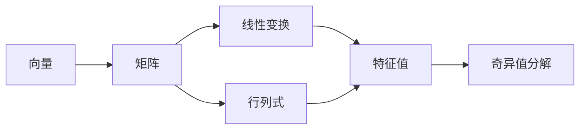

# 电子书结构化 —— 把书拆成可考试的骨架

> **先立规矩，否则这个模块会变成玩具工厂。**
>
> **先把依据说准，别拿错文献。**
>
> Dunlosky 等（2013）评 10 种学习技术时，被评为低效用的是 *imagery use for text learning*（读文时在脑内想象画面），**不是概念图，也不是思维导图**。
>
> 导图真正的依据是 Karpicke & Blunt 2011（*Science*）：「学习者自己建构概念图」vs「闭卷检索」，检索组一周后的延迟测验显著更好。
>
> **但这条证据有边界**：它测的是"自己画"，不覆盖"看 AI 生成的图"。所以「看别人做的图收益≈0」是推论，不是实验结论。
>
> 在这个前提下：**导图在本技能里是题目来源，不是阅读材料。** 这是设计立场，不是被证明的事实。
>
> 反过来用才对：**你先闭卷回忆 → 我对照标出你漏的 → 你补 → 我用图反向出题考你。**

---

## 0. 反模式 vs 正模式

| | 做法 | 收益 |
|---|---|---|
| ❌ 反模式 | 你发一本书 → 我直接吐一张全书导图 | ≈0（生成外包给你了） |
| ✅ 正模式 | 我提目录 → 你闭卷回忆每章骨架 → 我标差集 → 反向出题 → 最后交付导图 | 检索练习 + 精加工，双重收益 |

**如果用户只想要一张图**（"我就想看看这本书讲啥"），那按普通请求处理，直接给大纲，不进本流程。本流程的前提是「用户要学这本书」。

---

## 1. 提取（技术分水岭）

### EPUB —— 标准库可解，无需安装任何东西

EPUB 本质是 zip + XHTML。`scripts/extract_book.py` 用 `zipfile` + `xml.etree` 直接读 OPF 导航，产出：

```
~/.study-os/atlas/<slug>/
├── outline.json      # 层级目录树（章/节/小节 + 字数估计）
├── <slug>.md         # 全文 markdown（按章切分）
└── meta.json         # 书名、作者、章节数、总字数
```

### PDF —— 标准库做不到，必须降级

PDF 没有统一的结构标记，提取需要版面分析。两条路：

| 情况 | 做法 |
|---|---|
| 已装 PyMuPDF | `pip install pymupdf`，脚本自动启用，能提文字 + 目录书签 |
| 没装 | **降级**：让用户提供目录（截图 / 手动贴 / 书的目录页照）→ 我据此建 `outline.json`，内容按需逐章喂 |
| 扫描版（图片 PDF） | 必须 OCR，超出本技能范围，明确告知 |

**不许假装能提。** 提不出来就直接说，别给一个残缺的目录树冒充。

---

## 2. 五步流程（核心）

### 第 1 步 · 我提结构，但不给你看细节

只给**层级**（章标题），不给每章内容：

> 「这本书 6 章。目录我先贴出来：
> 1. 向量空间 2. 线性变换 3. 特征值 ……
> 现在**别看正文**，凭印象告诉我：第 3 章你觉得讲什么？它和第 2 章是什么关系？」

这一步的目的是让用户**暴露真实的前置知识**。很多人以为自己知道"特征值是什么"，一开口就露馅。

### 第 2 步 · 闭卷回忆（每章单独做）

一次一章，别贪多。

> 「第 3 章，三件事：
> ① 这章要解决什么问题？
> ② 核心定义/公式是什么（写出来，别看）？
> ③ 它和前一章的联系是什么？
> 写在纸上或打出来都行，写完发我。」

给 5–10 分钟。**这期间不要给任何提示。**

### 第 3 步 · 标差集（这是整个流程最值钱的一步）

对照书里真实内容，把用户回忆分成三类：

| 类别 | 标记 | 含义 | 后续 |
|---|---|---|---|
| ✅ 命中 | 说对了 | 已掌握 | 8 天后抽测一次即可 |
| ⚠️ 偏差 | 说了一部分/方向偏 | 半懂，最危险 | 立刻做靶向追问 |
| ❌ 空白 | 完全没提到 | 未学或已忘 | 进最小示范 + 入卡 |

输出成一张对照表，**不直接讲正确内容**：

> 「你写了 4 条，命中 2 条，偏差 1 条，漏了 3 个关键点。
> 先说偏差那条：**你说"特征值就是让矩阵变成零的数"** —— 这个描述会导致什么后果？你代入 A=[[2,0],[0,2]] 试试，按你的说法特征值是多少？书上说是多少？」

### 第 4 步 · 反向出题（用图考人，不是用人看图）

从导图节点**反向生成题目**，题型按层分配：

| 图上的节点类型 | 该出什么题 |
|---|---|
| 章标题 | 「这章为什么排在这里？去掉它，后面哪章会读不懂？」 |
| 核心定义 | 「不看书写出定义，然后举一个**不是**例子」 |
| 公式 | 「这个公式里每个符号的单位是什么？哪个量变大会让它失效？」 |
| 章间箭头（关系） | 「A 和 B 是什么关系？是特例、是推广、还是并列？举反例说明。」 |
| 易混概念 | 「这两个概念各造一个只满足其中一个的例子。」 |

**关键**：图是题目来源，不是阅读材料。用户看图的正确方式是被问，不是自己扫一遍。

### 第 5 步 · 交付可交互导图

到这一步才生成 HTML。文件含：

- 可折叠层级树（markmap，单文件）
- 每个节点带**掌握度标记**（✅ / ⚠️ / ❌，来自第 3 步的差集）
- 节点点击可展开"该点的检索题"（答案默认折叠）
- 章节复习日期（接入 SM-2 队列）

```bash
python scripts/build_atlas.py <slug>
```

---

## 3. 结构可视化：三层视图

用户要"结构清晰的可视化板块"，这里给三层，**按需出、不要一次全给**：

### 视图 1 · 目录树（用于定位）
纯层级，带字数。作用：知道书有多厚、哪里是重点。

### 视图 2 · 概念依赖图（用于理解顺序）
mermaid 图，**箭头表示"必须先懂 A 才能懂 B"**，不是表示"章的顺序"。



**箭头要说清方向含义**，否则这种图会变成装饰品。

### 视图 3 · 概念对照表（用于防混淆）
书里最容易混的 3–5 组概念，两列对比。这个视图检索价值最高。

| | 特征值 | 奇异值 |
|---|---|---|
| 存在条件 | 方阵 | 任意矩阵 |
| 几何意义 | 方向不变，只缩放 | 两组正交方向同时缩放 |
| 可能为负吗 | 可以 | 不可以 |

---

## 4. 与其他模块的衔接

- 书里每章过完 → 生成 3–5 张检索卡进 `cards.json`（间隔按章节难度定）
- 读书时遇到的例题做错 → 直接进错题工作流（`mistake-workflow.md`）
- 章节掌握度写入 `atlas/<slug>/mastery.json`，影响下次复习优先级

---

## 5. 反模式清单

| 反模式 | 为什么有害 |
|---|---|
| 发书就吐全书导图 | 生成外包，收益 ≈0 |
| 一次给三层视图 | 认知过载，用户不知道看哪个 |
| 导图只标"重点"不标"你漏了什么" | 少了差集，就退化为普通摘要 |
| 用户没回忆过就讲章节内容 | 直接进入"AI 解释、用户听"的零留存模式 |
| 用原题验证章节掌握 | 同上，短期记忆干扰 |
| PDF 提不出内容却硬给个残缺目录 | 比说"提不出来"更糟，用户会基于错结构学习 |

---

## 6. 一本 300 页书的实际耗时（给用户的心理预期）

| 步骤 | 我的耗时 | 你的耗时 |
|---|---|---|
| 提取 + 目录树 | 1–2 分钟 | 0 |
| 逐章闭卷回忆 | 0（等你） | 每章 5–10 分钟 |
| 标差集 | 每章 1 分钟 | 0 |
| 反向出题 | 每章 2 分钟 | 每题 2–3 分钟 |
| 生成导图 | 30 秒 | 0 |

**不要承诺"10 分钟读完一本书"。** 这本书要真学会，你至少得投入 3–6 小时。我的作用是把这 3–6 小时**花在有反馈的地方**，而不是帮你压缩成 10 分钟的假懂。
