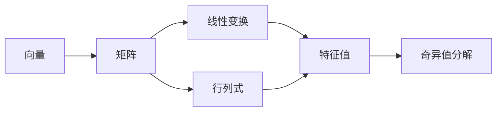

# 电子书结构化 —— 从「一章一章问」到「可考试的骨架」

> **先立规矩，否则这个模块会变成玩具工厂。**
>
> **先把依据说准，别拿错文献。**
>
> Dunlosky 等（2013）评 10 种学习技术时，被评为低效用的是 *imagery use for text learning*（读文时在脑内想象画面），**不是概念图，也不是思维导图**。
>
> 导图真正的依据是 Karpicke & Blunt 2011（*Science*）：「学习者自己建构概念图」vs「闭卷检索」，检索组一周后的延迟测验显著更好。
>
> **但这条证据有边界**：它测的是"自己画"，不覆盖"看 AI 生成的图"。所以「看别人做的图收益≈0」是推论，不是实验结论。
>
> 在这个前提下：**导图在本技能里是题目来源，不是阅读材料。** 这是设计立场，不是被证明的事实。
>
> 反过来用才对：**你先闭卷回忆 → 我对照标出你漏的 → 你补 → 我用图反向出题考你。**

---

## 0. 反模式 vs 正模式（v3 修订）

| | 做法 | 收益 |
|---|---|---|
| ❌ 反模式 1 | 你发一本书 → 我直接吐一张全书导图 | ≈0（生成外包给你了） |
| ❌ 反模式 2 | 一章一章问，但**每题都要你打一段话** | 输入成本超过收益，第三轮你就绕开这个工具 |
| ❌ 反模式 3 | 全程选择题，一道不写 | 你只练到「认得」，没练到「想得起」 |
| ✅ 正模式 | 一次一题、**以选择题推进**、每章末一道必答短答、最后交付导图 | 检索练习 + 精加工，且打字量降到十分之一 |

**如果用户只想要一张图**（"我就想看看这本书讲啥"），按普通请求处理，直接给大纲，不进本流程。本流程的前提是「用户要学这本书」。

---

## 1. 两条路：学，还是取

| 用户信号 | 走哪条 |
|---|---|
| 「带我啃」「问我」「一章一章」「别直接给我」 | **模式 A**（选择题陪读，§2） |
| 「直接生成」「整理成文档」「先看看结构」「来不及」 | **模式 B**（生成式速览，§3） |
| 没表态 | **默认 A**，第一句给二选一：「一章一章过，还是先出一份速览？」 |
| 「先出速览，再一章一章过」 | B → A 接力：先交付带校验的文档，再按章对话（文档当差集基准） |

**默认选 A 的理由**：A 有实证支持（检索练习），B 只省时间。默认值该站在收益那边。

---

## 2. 模式 A：选择题陪读（默认）

### 2.1 为什么改成选择题

原来的做法是每章让用户口述三件事（这章解决什么 / 核心定义 / 和前一章的关系）。收益没问题，但**一次要打一百多字**，用户第二次就懒得打，第三次直接绕开。

改成选择题，换来三件事：

| 收益 | 具体 |
|---|---|
| 输入成本降到 1 个字母 | 一章 4 题 = 打 4 个字符，20 秒 |
| **选错即定位** | 干扰项不是随便编的，每个错误项对应一类错因（见 §2.3）——你选了 B，我立刻知道你是概念误解还是迁移失败，不用再追问一轮 |
| 可以量化 | 每题的选择、改选、是否蒙对都落盘，比"我感觉这章懂了"可靠 |

**代价必须说清，不许含糊**：选择题考的是**识别**，不是**回忆**。选项本身会提供线索，认得出不等于想得出。有实验比较过测验形式（Smith & Karpicke, 2014, *Memory*）；方向是**简答/自由回忆的收益高于多项选择，多选在"只需要认出来"的测验上才追平**（二手转述，未核原文，置信度 B）。

所以这个模式有两条**逃不掉的护栏**：

1. 每章最后 1 题**没有选项**，必须自己说一句话（说错也算过，只要说了）
2. 每 3 章至少 1 次要求"说三个关键词"，而不是选字母

护栏被跳过时，只提醒一句，不阻止：「全程选择题，最后会给你一种认得但写不出的自信。」

### 2.2 一章的节奏：4 选择 + 1 短答

| # | 题型 | 测什么 | 你的输入 |
|---|---|---|---|
| 1 | 选择 · 这章要解决什么问题 | 全局定位 | 1 个字母 |
| 2 | 选择 · 核心定义 / 成立条件 | 精确性 | 1 个字母 |
| 3 | 选择 · **反向题**「下面哪个说法是错的」 | 边界 | 1 个字母 |
| 4 | 选择 · 与前一章的关系（特例 / 推广 / 并列） | 迁移 | 1 个字母 |
| 5 | **无选项** · 一句话说这章 | 回忆 | 一句话（≤30 字） |

**第 1 题之前不给任何内容**：只贴章标题，不许给"本章重点"。目的是暴露真实前置知识——很多人以为自己懂"特征值"，一开口就露馅。

### 2.3 选项的八条硬规则

出题不是随手写四个句子。以下每条都是可判定的：

| # | 规则 | 违反的后果 |
|---|---|---|
| 1 | 恰好 4 个选项，别用 5 个 | 5 个以上开始拼运气 |
| 2 | 每个干扰项**必须标错因**，取值 `K/M/P/R/T` | 选错也定位不到病灶，选择题唯一的诊断价值没了 |
| 3 | 不许零信息选项（以上都对 / 都不对 / 全都正确） | 这类选项不测知识，只测你排不排除它 |
| 4 | 正确项**必须写成立边界**（条件 / 当 / 若 / 只有 / 前提） | 只写"是什么"的题太浅，答对也没意义 |
| 5 | 禁止长度线索：正确项不能是唯一最长的 | 用户会学会按长度蒙，正确率虚高 |
| 6 | 正确项位置随机，**不许连续两题同一个字母** | 同上，位置也是线索 |
| 7 | 一题只考一个点 | 一题考三个点，答错不知道该补哪个 |
| 8 | 题干不许自带提示（"根据§3.2 的定义…"） | 等于把检索变成找茬 |

**四个错因的具体用法**（这是本模式的核心）：

| cause | 干扰项长什么样 | 例（线代·基与维数） |
|---|---|---|
| `M` 概念误解 | 听着很有道理、但是错的模型 | 「向量个数正好等于空间的维数」 |
| `K` 知识缺口 | 术语错配，对象张冠李戴 | 「每个向量都是单位向量」 |
| `T` 迁移失败 | **上一章/相邻概念的正确答案** | 「向量个数不超过维数」（对，但那是无关组的性质） |
| `R` 表征错误 | 把条件改写掉（任意↔方阵、充要↔充分） | 「两两正交且长度都为 1」（那是标准正交基） |

`M` 型必须占干扰项的两成以上——没有 `M` 的题库会变成送分题（`check_quiz.py` 会报 W4）。

### 2.4 出完题先跑质检，过不了不许拿去问

```bash
python scripts/check_quiz.py <slug>          # 读 ~/.study-os/atlas/<slug>/quiz.json
python scripts/check_quiz.py path/quiz.json  # 也可以直接给文件
```

脚本把上面八条里能算的变成检查项：E 类（选项数、字母重复、correct 指向不存在、干扰项缺错因、零信息词）**必须修**；W 类（长度线索、正确项没写边界、`M` 占比不足、某章无题、某章全是选择题）**建议修**。

**有 ERROR 就不许把题发给用户。** 这一条同样适用于我自己临场编的题——编完先在脑子里跑一遍规则，尤其是第 5 条（别让正确项最长）。

### 2.5 一条消息长什么样（照抄这个格式）

```
第 3 章 · 2/5　核心定义

「可对角化」的充要条件是什么？

A. 矩阵有 n 个互不相同的特征值
B. 矩阵有 n 个线性无关的特征向量
C. 矩阵的行列式不为零
D. 矩阵的特征值全为实数

回一个字母就行。`?` 要提示（不给答案）｜`跳过` 不记罚｜`换一批` 换套说法
```

- 一屏只放**一题**，不许一次抛五题
- 每次带进度（2/5），让用户知道还剩多少
- 底部固定一行快捷指令，用户不用记暗号

### 2.6 答错三步 / 答对抽样追问

**答错：不许立刻判卷报答案。** 顺序固定：

| 步 | 动作 | 话术 |
|---|---|---|
| 1 | 反问他选的那项**在什么条件下成立** | 「你选 B。B 这个说法在哪种矩阵上成立？说出来我就告诉你差在哪。」 |
| 2 | 说不清 → 给最小提示（指回章节位置，不念内容） | 「回看 3.2 那个反例，看它为什么故意用了两个相同的特征值。」 |
| 3 | 仍不行 → 最小示范 + **让他改选一次** | 「现在再看这四个选项，你想改哪个？」 |

- 改选对了 → 掌握度记 `warn`（**不是 ok**，第一次确实错了）
- 第二次还错 → 记 `blank`，入错题库，`cause` 用干扰项标好的那个错因
- 三步里任何一步用户说"直接说" → 见 `core-rules.md` §9 逃生阀，给答案但要记进错题库

**答对：抽样追问一句，不追三层。** 只问**第 2、4 题**（核心定义题、章间关系题）：

> 「对了。那为什么不是 A？一句话。」

答不出 → 掌握度记 `warn`，并标 `lucky: true`（蒙对的）。这是防"选项眼熟就选"的唯一手段。

### 2.7 快捷指令（写进模板底部，别让用户猜）

| 输入 | 处理 |
|---|---|
| `A` / `B` / `C` / `D` | 作答 |
| `?` | 给一个提示，**不揭示答案**；每章最多 2 次，第 3 次直接给最小示范 |
| `跳过` | 跳过本题，掌握度记 `skipped`，**不加罚不记账** |
| `换一批` | 同一知识点换一套选项重问（防背选项不背内容） |
| `下一章` | 推进，不主动连推 |
| 只回「嗯」「哦」「行吧」 | 降档：只给结论 + 一句差集，不再追问 |

### 2.8 章末落盘（不落盘等于没发生）

一章 5 题问完，四件事必须做完：

| 动作 | 落点 |
|---|---|
| 掌握度标记 | `mastery.json`：`ok` / `warn` / `blank` / `skipped` |
| 题目本身 | `atlas/<slug>/quiz.json`（含 options / cause / correct） |
| 每题结果 | `logs/sessions.jsonl`，`kind: "quiz_answer"`（见 `schemas.md`） |
| 3–5 张检索卡 | `python scripts/review.py add -q … -a … -t …` |

做完再出 30 秒小结：**只放差集表**（你漏了什么），不是章节摘要。摘要功能交给模式 B。

**这一章如果有反复卡住的知识点**，可以在小结末尾附一条外部讲解（最多一条）。走 `resources.py pick` 取，不许凭记忆写链接，必须写明第几讲/几分几秒。完整规则见 `resource-anchors.md`。

时机是硬约束：**答案之后才给，题目旁边绝不给**——链接就是答案的入口，放在题旁边等于把这道题废了。

### 2.9 节奏控制（防弃用、防过难）

| 情形 | 处理 |
|---|---|
| 连续两章大面积 `blank` | 直说「这本书的前置难度可能超出当前水平」，建议降档到模式 B 速览，或先补前导章 |
| 答得又快又准 | 提层级：把第 4 题换成"构造一个反例"，或临时加一道无选项题 |
| 说「跳过这章」 | 直接跳，记 `skipped`，不追问 |
| 连续 3 题都靠 `?` 提示 | 停止提问，改讲最小示范，本章降为 `blank` 入错题库 |

---

## 3. 模式 B：生成式速览（"取"不是"学"）

### 3.1 产出物（三件套，缺一不可）

| 文件 | 内容 | 落盘路径 |
|---|---|---|
| 结构化笔记 | 按章 → 节展开，每节含：核心问题 / 关键定义 / 公式或模型 / 一个例子 / 常见误解 | `atlas/<slug>/digest.md` |
| 可交互知识地图 | `build_atlas.py` 产出，节点带掌握度占位 | `atlas/<slug>/atlas.html` |
| 概念对照表 | 3–5 组易混概念两列对比 | `digest.md` 末节 |

### 3.2 头部必须写这段（防误用）

> 这份是**速览**，不是学会。它省了你整理的时间，但没有替你建立记忆。
> 正确用法：合上它，先自己讲一遍这章讲什么 → 再打开对照漏了什么 → 从末尾的题目里抽 3 道闭卷答。

### 3.3 交付前五项校验（用户明确要求的核心）

**原则：没通过校验的内容不许交付。** 校验不是"我读一遍觉得挺好"。

| # | 检查 | 通过标准 | 谁来判 |
|---|---|---|---|
| C1 | **覆盖率**：`outline.json` 每个节点都要在产出物里出现（标题或核心术语） | 缺失 0 个 | **脚本** |
| C2 | **溯源率**：每条定义/公式/结论后面能定位 `[§3.2]`；无法溯源的一律标 `（推断，非原文）` | 可溯源 ≥ 80%，推断 ≤ 20% | **脚本**（含节级兜底） |
| C3 | **三件套齐备**：每个核心概念有 定义 / 公式 / 一个例子 / 适用条件 | 核心概念 100% | **脚本** |
| C4 | **一致性**：术语全书统一；同一概念前后条件不冲突；公式代进例子真算一遍 | 0 处未解释的矛盾 | 半自动：脚本列出"该算没算"的节，数值**必须用 Python 真代** |
| C5 | **白纸复述**：① 全书核心问题是什么 ② 方法论主线 ③ 哪两章最易读成同一件事 ④ 只留三章删哪三章 | 4 问都答得出 | 人工（脚本只打印清单） |

**入口**：

```bash
python scripts/verify_atlas.py <slug>              # 读 ~/.study-os/atlas/<slug>/
python scripts/verify_atlas.py path/to/digest.md   # 也可直接指文件
```

**退出码 0 才能交付，1 不许交付。** 结构照 `templates/digest.md` 填，脚本才认得出标题和 `[§]` 标记。

**C2 的分母写死在这里，因为这是最容易作弊的一格**：分母是「断言行」——在陈述书中知识的那些行。排除的只有三类，每一类都是**本来就不该有页码**的东西，不是「不方便溯源」的东西：

| 排除 | 为什么 |
|---|---|
| `验算/推导/代入` 开头的行 | 那是我自己算的，出处是我的算式不是原书。数值对不对归 C4 管 |
| 「闭卷/自测/答案」整节 | 题目和答案不是知识断言 |
| 代码块里的公式 | 公式本体不携带语义，出处标在引入它的那句 `**公式** [§1.1]` 上 |

另有一条**节级兜底**：每个节至少要有一处 `[§]`。行级比例能被稀释——把长句拆成短句，无标记行的占比立刻降下来。整整一节没出处，比例再好看也不许交。

**任一项不过 → 先修再交。** 交付时贴脚本原始输出，不许写"已检查完毕"。

> ⚠️ 老实说：C4 的"真代一遍"脚本替不了。它只能列出"含数字又含例子、但没有验算式"的节，让你去补。别把 C1–C3 的 PASS 当成五项全过——脚本结论里明写「C4/C5 仍需人工」。

---

## 4. 提取（技术分水岭）

### EPUB —— 标准库可解，无需安装任何东西

EPUB 本质是 zip + XHTML。`scripts/extract_book.py` 用 `zipfile` + `xml.etree` 读 OPF 导航，产出：

```
~/.study-os/atlas/<slug>/
├── outline.json      # 层级目录树（章/节/小节 + 字数估计）
├── <slug>.md         # 全文 markdown（按章切分）
└── meta.json         # 书名、作者、章节数、总字数
```

**真实书上会撞到的三种结构**（都不是偶发，是常态）：

| 现象 | 原因 | 脚本现在的处理 |
|---|---|---|
| 目录里**整整少一章**，还不报错 | OPF 的 href 是 percent-encoding（`%E7%AC%AC%201%20%E7%AB%A0…`），zip 条目名是原文，`zf.read()` 抛 KeyError，旧代码直接 `continue` | href 一律先 `unquote` 再查；真找不到就打 `[warn] 已跳过`，不许静默 |
| 标题提取到了，**字数 0** | 段落包在 `<div class="para">` 里，不套 `<p>`（转换工具常这么干） | 认 div/td/blockquote 为块级容器 |
| 一开就报错 / 抽出乱码 | 有 DRM（`META-INF/encryption.xml`） | 检测加密目标是不是 xhtml/opf，是就**直接说解不开**，给出替代路径 |

字体混淆（只加密字体）不拦——那种正文能读。

### PDF —— 标准库做不到，必须降级

| 情况 | 做法 |
|---|---|
| 已装 PyMuPDF | `pip install pymupdf`，脚本自动启用，能提文字 + 目录书签 |
| 没装 | **降级**：让用户提供目录（截图 / 手动贴）→ 据此建 `outline.json`，正文按需逐章喂 |
| 扫描版 | 必须 OCR，超出范围，明确告知 |

**不许假装能提。** 提不出来就说，别给一个残缺目录冒充。

---

## 5. 结构可视化：三层视图

按需出，**不要一次全给**（会过载）。

### 视图 1 · 目录树（定位）
纯层级 + 字数。知道书多厚、哪里是重点。

### 视图 2 · 概念依赖图（理解顺序）
mermaid，**箭头表示"必须先懂 A 才能懂 B"**，不是章的顺序。



### 视图 3 · 概念对照表（防混淆，检索价值最高）

| | 特征值 | 奇异值 |
|---|---|---|
| 存在条件 | 方阵 | 任意矩阵 |
| 几何意义 | 方向不变，只缩放 | 两组正交方向同时缩放 |
| 可能为负吗 | 可以 | 不可以 |

---

## 6. 反模式清单

| 反模式 | 为什么有害 |
|---|---|
| 发书就吐全书导图 | 生成外包，收益 ≈0 |
| **每章让用户口述三百字** | 输入成本压垮收益，用户第三次就绕开 |
| **四个选项塞一个明显荒谬的** | 正确率虚高，掌握度全错 |
| **正确项永远最长 / 永远选 A** | 用户学会按长度和位置蒙，测的不是知识 |
| **全程选择题，一道短答都不写** | 只练到识别，考试要写的时候写不出 |
| **同一知识点反复用同一套选项** | 用户背下选项位置，`换一批` 就是为了防这个 |
| 一次给三层视图 | 认知过载 |
| 导图只标"重点"不标"你漏了什么" | 少了差集，退化为普通摘要 |
| 用户没回忆过就讲章节内容 | 进入"AI 解释、用户听"的零留存模式 |
| PDF 提不出却硬给残缺目录 | 比说"提不出来"更糟 |

---

## 7. 一本 300 页书的实际耗时

| 步骤 | 我的耗时 | 你的耗时 |
|---|---|---|
| 提取 + 目录树 | 1–2 分钟 | 0 |
| 出题 + 跑 `check_quiz.py` | 每章 2 分钟 | 0 |
| 一章 5 题（模式 A） | 0（等你） | **每章 2–4 分钟** |
| 章末短答 | 0 | 30 秒 |
| 生成导图 | 30 秒 | 0 |

选择题把每章从 5–10 分钟压到 2–4 分钟。但**别指望它变成 30 秒**：多选题省的是打字，不是思考。

**不要承诺"10 分钟读完一本书"。** 真学会，你还是得投入 2–5 小时。我的作用是把这些时间花在有反馈的地方。

---

## 8. 与其他模块的衔接

- 每章过完 → 3–5 张检索卡进 `cards.json`（间隔按章节难度定）
- 章末短答答成空白 → 直接进错题工作流（`mistake-workflow.md`），错因通常记 `K` 或 `E`
- 选择题选错的 cause 直接复用七类错因代号，和错题库同一套语言
- 章节掌握度写入 `atlas/<slug>/mastery.json`，影响下次复习优先级
- 某章连续两轮都不过 → 这是"讲法不合口味"的信号，用 `resources.py pick --topic <该章>` 找一条换个讲法，别重复同样的解释
